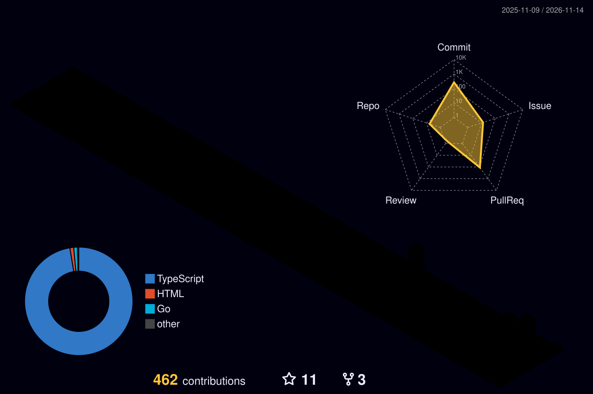

  
  
  
  

---

## 👋 About me

I'm a full-stack developer who likes building things end to end — from the database schema to the pixel on screen.

- 🛠️ **Mostly TypeScript:** Next.js, React, Node/Express, MongoDB, Redis, Docker
- 🤖 **AI & computer vision:** MediaPipe, OpenCV, LLM-assisted tooling
- ⚡ **Real-time systems:** live timing feeds, WebSockets, streaming state
- 🐧 **Linux at heart:** I enjoy working close to the OS — compositors, PTYs, shells
- 💬 **Ask me about:** DataWeave, Formula 1, or anything Linux

---

## 🔭 Right now

- 🧩 Growing **[DWCode](https://dwcode.vercel.app)** — contests and AI-assisted hints for DataWeave learners
- 🏎️ Shipping live GPS-accurate track maps in **F1 Live**
- 🫥 Verifying screencast exclusion for **InviTerminal** on KDE Plasma 6
- 🤝 Open to full-stack roles, freelance work and interesting collaborations

---

## 🚀 Featured projects

<table>
<tr>
<td width="50%" valign="top">

### 🧩 [DWCode](https://github.com/bighnesh0007/dwcode)
A LeetCode-style practice platform for **MuleSoft DataWeave** — problems, a live playground, contests and AI-assisted learning.

[**🌐 Live demo**](https://dwcode.vercel.app) · [Code](https://github.com/bighnesh0007/dwcode)

</td>
<td width="50%" valign="top">

### 🏎️ [F1 Live](https://github.com/bighnesh0007/F1)
A real-time Formula 1 companion: live timing tower, track map with every car, battle tracker, race alerts, standings and replays — all from real data.

[Code](https://github.com/bighnesh0007/F1)

</td>
</tr>
<tr>
<td width="50%" valign="top">

### 🫥 [InviTerminal](https://github.com/bighnesh0007/InviTerminal)
A developer terminal that asks the compositor to keep its window **out of screen capture** — then verifies it actually did. Snippet library, live transcript and Ask-AI threads.

[Code](https://github.com/bighnesh0007/InviTerminal)

</td>
<td width="50%" valign="top">

### ✨ [Snap Vanish](https://github.com/bighnesh0007/gmeetEffects)
Snap your fingers on camera and **disintegrate into dust** in Google Meet — snap again to reappear. Portable, no admin rights, all models run locally.

[Code](https://github.com/bighnesh0007/gmeetEffects)

</td>
</tr>
<tr>
<td colspan="2" valign="top">

### 📈 Algorithmic trading bot (private)
An intraday NSE trading bot with risk-governed execution, broker-side OCO stop-losses, backtests and an n8n-driven paper forward test. Safe by default — dry-run unless explicitly enabled.

</td>
</tr>
</table>

---

## 🧰 Tech stack

**Languages** 

**Frontend** 

**Backend & data** 

**AI / ML** 

**DevOps & tools** 

---

## 📊 GitHub stats

<picture>
  <source media="(prefers-color-scheme: dark)" srcset="https://raw.githubusercontent.com/bighnesh0007/bighnesh0007/output/profile-night-rainbow.svg" />
  <source media="(prefers-color-scheme: light)" srcset="https://raw.githubusercontent.com/bighnesh0007/bighnesh0007/output/profile-gitblock.svg" />
  
</picture>

---

## 🐍 Contribution snake

<picture>
  <source media="(prefers-color-scheme: dark)" srcset="https://raw.githubusercontent.com/bighnesh0007/bighnesh0007/output/github-snake-dark.svg" />
  <source media="(prefers-color-scheme: light)" srcset="https://raw.githubusercontent.com/bighnesh0007/bighnesh0007/output/github-snake.svg" />
  
</picture>

---

Thanks for stopping by — feel free to reach out about a project, a role or Formula 1. 🏁

